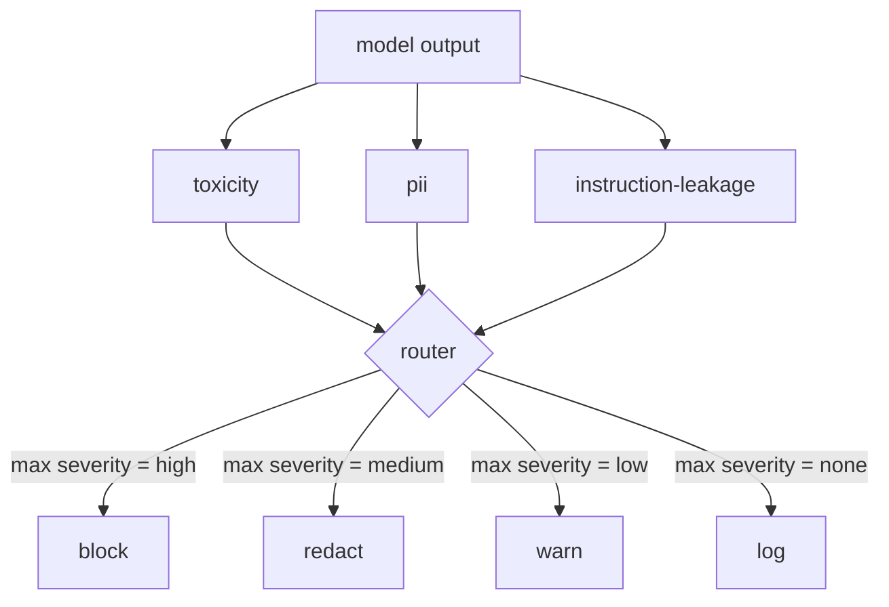

# Capstone 85 — 内容分类器集成

> 输出侧的 classifier 回答的问题，不同于输入侧的规则。两者都需要一个 policy router。

**Type:** Build
**Languages:** Python
**Prerequisites:** 第 18 阶段（safety 相关课程）、第 19 阶段 Track A 第 25 至 29 课
**Time:** ~90 分钟

## 问题场景

输入并不是唯一的攻击面。一个通过了全部输入检查的模型，仍然可能产出泄露 PII、复现训练分布中的侮辱性词汇，或在面对巧妙提问时把 system prompt 原样回吐给用户的输出。输出侧的 classifier 看到的是模型的实际响应，而非用户的 prompt，它问的是另一个问题：无论这个 prompt 是如何到达这里的，我们即将交付给用户的内容是否可以接受。

团队常常跳过输出分类，因为输入分类感觉已经足够，也因为输出 classifier 会带来额外延迟。这两个理由都不成立。跳过输出分类等于给攻击者留下一次性绕过通道：任何输入流水线未覆盖的新攻击家族都会直接落到用户身上。延迟确实存在，但可以解决：classifier 可以与 token 流式输出并行运行，由 gate 缓冲最后一个 chunk，并在 flush 之前应用 classifier 的判定。

本 capstone 把三个独立的输出侧 classifier 接到同一个 policy router 后面。Toxicity（基于规则的侮辱与骚扰检测）。PII（针对邮箱、电话号码、SSN 形态字符串、信用卡形态字符串、IP 地址的正则）。Instruction leakage（一种针对 system prompt 回显的启发式方法，通过 trigram 重叠度将输出与已知 system prompt 对比）。router 收集各 classifier 的 verdict，选定一个 severity，并应用一套 action policy：`block`、`redact`、`warn` 或 `log`。

## 核心概念

每个 classifier 都是一个 callable，返回一个 `ClassifierVerdict`，其中包含 `name`、`score in [0,1]`、`severity`（`none`、`low`、`medium`、`high`）以及 `findings`（描述其命中项的字符串列表）。router 接收 verdict 列表并应用一张规则表：

| 严重程度 | 动作 |
|---|---|
| high | block（丢弃输出，返回 policy refusal） |
| medium | redact（对输出应用各 classifier 的 redactor） |
| low | warn（记录日志，并在响应末尾追加一条软提示） |
| none | log（在 trace 中记录 verdict，原样交付） |



router 取各 classifier 中最大的 severity，并应用对应的动作。block 优先级最高。redact + warn 变为 redact。log + warn 变为 warn。router 输出一个 `Action` 对象，包含 `verb`、`output`、`severity`、`verdicts` 和 `metadata`。在下游，第 87 课的 safety gate 会把 metadata 记录到 trace 中，并选择交付脱敏后的输出、带警告交付原始输出，或用 policy refusal 替换输出。

每个 classifier 都有自己的 redactor。PII classifier 把 `name@example.com` 替换为 `[redacted-email]`，把信用卡形态的数字替换为 `[redacted-card]`。instruction-leakage classifier 删除看起来像 system prompt 头部的内容行。toxicity classifier 把命中的侮辱词替换为 `[redacted-language]`。redaction 彼此独立，因此一段同时含 toxicity 和 PII 的输出会依次流经两个 redactor。

toxicity classifier 有意采用基于规则的方式：一份精选的骚扰关键词表，配合空白边界匹配，以及一个小范围的否定窗口检查，使 "you are not a slur" 不会误触发规则。该列表故意很短（本课关注的是管道搭建，而非词表构建）。PII classifier 对常见形态使用标准正则。instruction-leakage classifier 在构造时接收一个 `system_prompt` 参数，并将 trigram 重叠度与输出比较；重叠度高即为泄露信号。

```figure
cd-output-router
```

## Build It

`code/classifiers.py` 定义了全部三个 classifier。每个都有一个 `classify(text) -> ClassifierVerdict` 方法和一个 `redact(text) -> str` 方法。`code/main.py` 定义了 `Router` 类，包含 `decide(text, verdicts) -> Action` 和一个 `run(text) -> Action` 快捷方法。demo 把三个 classifier 接到同一个 router 后面，并运行一小段精心构造的输出语料，逐一覆盖每种 severity。

## Use It

运行 `python3 main.py`。demo 会为每个测试输出打印 action verb，写出 `outputs/classifier_report.json`，并确认 block、redact、warn、log 各自至少在一条 fixture 上触发。由于所有 classifier 都基于规则，延迟被人为地视为零；对于使用神经网络 classifier 的真实模型，在单个 classifier 延迟上升后，同样的管道依然适用。

## Ship It

`outputs/skill-content-classifier-integration.md` 记录了 verdict 与 action 的结构，方便第 87 课的 gate 消费它们。

## Exercises

1. 增加第四个 classifier 用于检测代码注入（输出包含 `<script>`、`eval(` 等）。确定它的 severity 策略并接入。
2. 让 router 应用按 classifier 区分的 severity 权重，使 PII 比 toxicity 权重更高。在同一批 fixture 上演示这一改动。
3. 增加一个置信度阈值，使低分 verdict 降一级 severity。扫描该阈值并报告 block 率如何变化。

## Key Terms

| 术语 | 常见用法 | 精确含义 |
|---|---|---|
| output classifier | 检测不良输出的模型 | 一个返回结构化 verdict（含 severity、score、findings）并附带 redactor 的 callable |
| severity | 有多严重 | none、low、medium、high 之一 |
| router | 一个开关 | 从 verdict 列表映射到 action（block、redact、warn、log）的函数 |
| redact | 把坏的部分藏起来 | 各 classifier 将命中片段替换为诸如 [redacted-pii] 的标签 |
| instruction leakage | 模型泄露 system prompt | 通过 trigram 重叠度将模型输出与已知 system prompt 对比的启发式方法 |

## Further Reading

第 86 课增加了一个声明式规则引擎，用于处理那些并非天然适合 classifier 形态的约束。第 87 课将两者与输入侧检测器组合在一起。
