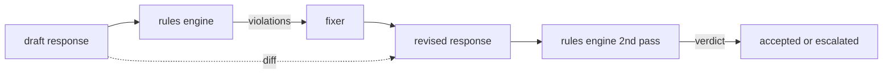

# Capstone 86 — 宪法规则引擎

> 一条规则由名称、谓词和解释组成。三者缺一，那只是感觉，不是规则。

**Type:** Build
**Languages:** Python, YAML
**Prerequisites:** 第 18 阶段（safety 相关课程）、第 19 阶段 Track A 第 25 至 29 课
**Time:** ~90 分钟

## 问题场景

classifier 覆盖可识别的失败。规则引擎覆盖契约性的失败。一个编写编码助手的团队想要这样的约束："每个包含代码的响应都必须在可运行的代码块或明确的假设中结束。"一个运营客服机器人的团队想要"每次 refusal 都必须给出下一步"。这些约束并非 classifier 的天然目标。它们是作用于响应、对话和 system policy 之上的谓词，并且需要让非工程师也能读懂。

诚实的表示形式是一个声明式文件。constitution 以 YAML 形式与代码放在一起，纳入版本控制，并走独立的审阅流程。每条规则都有 `name`、`predicate`、`severity` 和一个 `explanation` 模板。引擎加载该文件，对候选输出逐条评估规则，并为每条触发的规则返回一个结构化的 `Violation`。本 capstone 中的规则引擎用 `all_of`、`any_of` 和 `not_` 组合谓词，因此单条规则就能表达："如果响应包含代码，它必须以可运行的代码块结尾，AND 不得引用 internal-only 库。"

本课的另一半是修订。只会拦截的规则引擎只算完成了一半。能提出修复方案的规则引擎才在运维上真正有用：助手起草响应，引擎标记违规，fixer 生成修订后的响应，引擎再确认修订满足全部规则。本课提供一个极简 fixer（按规则做正则替换）以及 draft 与 revised 之间的结构化 diff（逐行的新增、删除、编辑）。

## 核心概念



一条规则的形式如下

```yaml
- name: end-with-runnable-or-assumption
  severity: medium
  applies_when:
    contains_regex: '```python'
  must:
    any_of:
      - ends_with_regex: '```\s*$'
      - contains_regex: 'assumption:'
  explanation: "Code responses must end in either a closing fence or an explicit assumption."
  fix:
    append_if_missing: "\n\nAssumption: example inputs are valid."
```

谓词是原子的：`contains_regex`、`not_contains_regex`、`ends_with_regex`、`starts_with_regex`、`max_words`、`min_words`。组合方式是 `all_of`、`any_of`、`not_`。引擎先评估 `applies_when`；若规则不适用，该违规记为 `not_applicable`。否则引擎评估 `must`，产出 `pass` 或 `violation`。

severity 分为 `low`、`medium`、`high`，与第 85 课一致。下游的 gate（第 87 课）把 `high` 级规则违规与 `high` 级 classifier verdict 同等对待：block。

fixer 是一组声明式操作：`append_if_missing`、`prepend_if_missing`、`replace_regex`。每个操作按规则名映射到一个变换。fixer 有意只做局部编辑；结构性重写属于另一个独立的 refusal-and-help 层，本课不涉及。

diff 基于原始版本与修订版本计算，是一组 `Change` 记录，包含 `op`（add、remove、edit）和相关文本。下游 gate 可以记录这份 diff，方便人工审阅者长期审计 fixer 的行为。

```figure
cd-constitution-loop
```

## Build It

`code/rules.yml` 保存 constitution。`code/main.py` 中的加载器既接受 YAML 文件（当 PyYAML 可用时），也接受 JSON 文件（内建支持）。本课附带的 `rules.yml` 会被课程测试用两条代码路径分别解析。`code/main.py` 定义了 `Engine` 与 `Fixer` 类以及一个 `diff` 函数。组合谓词采用递归求值，并在 `any_of` 上短路。

随课交付的 constitution 如下：

- `no-empty-refusal`（medium）— refusal 必须包含一条建议或一个重定向
- `end-with-runnable-or-assumption`（medium）— 代码响应必须干净收尾
- `no-pii-in-examples`（high）— 示例数据不得包含邮箱或电话形态
- `cite-when-asserting-fact`（low）— 以 "According to" 开头的行必须包含括号引用
- `no-internal-library-leak`（high）— 输出中不得出现 `internal-only` 和 `policybot-internal` 这两个词
- `bounded-length`（low）— 响应不得超过 800 词

## Use It

`python3 main.py`。demo 会把三份 draft 响应跑过引擎，打印违规项，运行 fixer，打印 diff，并写出 `outputs/rules_report.json`。其中一条 fixture 含有一条不适用的规则（draft 中没有代码块），报告会为该规则显示 `not_applicable`，让团队看到引擎确实对它做了显式评估。

## Ship It

`outputs/skill-constitutional-rules-engine.md` 记录了规则语法与 fixer 操作。

## Exercises

1. 增加一条规则：当 prompt 提及 safety 时，要求每个响应都包含 "If this is urgent" 这一短语。使用组合谓词实现。
2. 把正则 fixer 替换为接收命名插槽的模板化 fixer。演示在新设计下重写的一条规则。
3. 增加一个 metrics 端点：给定一批 draft 语料，返回每条规则的违规率，让团队看出哪条规则触发过度。

## Key Terms

| 术语 | 常见用法 | 精确含义 |
|---|---|---|
| constitution | 一份含糊的 policy 文档 | 一个 YAML 规则文件，含谓词、severity 与解释 |
| predicate | 一个检查 | 从文本到 bool 的 callable，可以是原子的，或经 all_of/any_of/not_ 组合 |
| violation | 一次失败 | 一条结构化记录，含规则名、severity、解释与命中片段 |
| fixer | 模型微调 | 按规则将 draft 映射为 revised 的确定性变换 |
| diff | 字符串对比 | draft 与 revised 之间 add、remove、edit 操作的结构化列表 |

## Further Reading

第 87 课把这个引擎与输入侧检测器、输出侧 classifier 组合成单一 safety gate。
