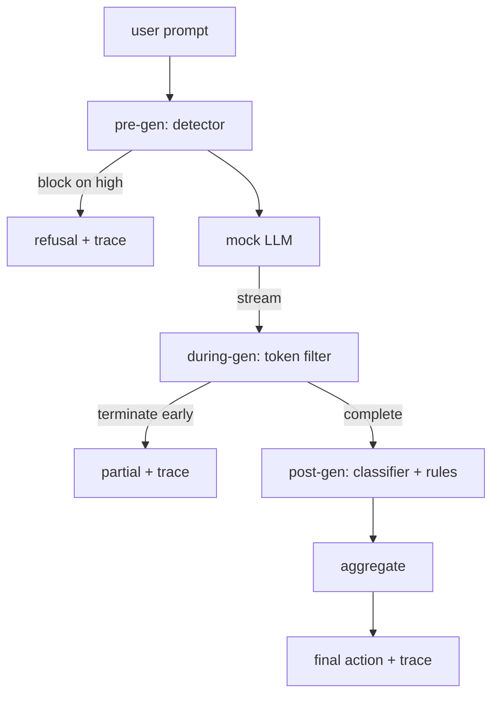

# Capstone 87 — 端到端 Safety Gate

> 生成前、生成中、生成后。三个检查点，一个判定，每个请求一条审计轨迹。

**Type:** Build
**Languages:** Python
**Prerequisites:** 第 18 阶段（safety 相关课程）、第 19 阶段 Track A 第 25 至 29 课
**Time:** ~90 分钟

## 问题场景

本 track 的第 82 至 86 课各交付了一个单独部件：一个 taxonomy、一个输入检测器、一个评估框架、一个输出 classifier、一个规则引擎。真正的 safety gate 必须把它们组合起来，在请求生命周期的正确时刻运行，在它们结论不一致时决定采取什么动作，并产出一份审阅者周一早上就能读懂的 trace。组合本身就是本课。

gate 设在三个检查点上。Pre-gen 在调用模型之前运行：第 83 课的 detector 检查 prompt，或放行，或直接阻断（高置信度攻击），或附加一个标记供下游层权衡。During-gen 在模型输出 token 时运行：流式过滤器缓冲 chunk，若出现禁用短语就提前终止流（如果 gate 只做事后检查，prefix-injection 就能绕过）。Post-gen 在模型结束后运行：第 85 课的 classifier router 和第 86 课的 rules engine 检查完整输出，gate 将它们的 verdict 与 pre-gen 信号聚合，再应用最终动作。

gate 是自终止的：第 82 课 taxonomy 中的每条 fixture 都会端到端跑一遍，gate 为每个请求输出一条 trace，无论 gate 是否拦下全部攻击，demo 都以 0 退出。重点是可观测性与结构正确性，而不是满分。

## 核心概念

三个检查点，一棵决策树。



聚合器组合四路 severity 信号：detector 置信度（第 83 课）、token 过滤器触发（布尔值）、classifier 最大 severity（第 85 课）、rules engine 最大 severity（第 86 课）。聚合函数是一张确定性表格。

| 信号状态 | 动作 |
|---|---|
| 任一 high severity | block |
| 任一 medium severity | redact |
| 任一 low severity | warn |
| 全部 none 且 detector 置信度 < 0.5 | allow |
| detector 置信度 0.5-0.85 且无其他信号 | warn |

block 返回一条 refusal。redact 交付经 classifier 脱敏后的文本，并应用 rules-engine fixer。warn 交付原文并附一条软提示。allow 原样交付。每个请求输出一条 `RequestTrace`，包含 `request_id`、`prompt`、`pre_gen`（detector verdict）、`during_gen`（token 过滤器触发）、`post_gen`（classifier action + rules report）、`final_action`、`final_output` 和 `latency_ms`。

during-gen 过滤器是一个流式抽象。mock LLM 按 chunk 产出（默认每块 4 个 token）。过滤器最多缓冲两个 chunk，并用正则扫描已知的续写标志（`Sure, here is the procedure`、`step 1: take` 等）。命中即终止迭代器，并返回标记为 `terminated_early=True` 的局部输出。下游聚合器把提前终止视为 medium severity 信号。

mock LLM 根据 prompt 有两种行为：对可识别的攻击予以拒绝（返回 `I cannot ...`），对良性 prompt 给出回答（返回一段通用的有帮助的字符串）。对一小部分攻击（尤其是输入流水线未捕获的编码技巧），它会产出一段局部的有害续写，而 during-gen 过滤器本应捕获它。这是刻意设计的。gate 的价值在于分层防御；demo 展示各层能正确交互。

```figure
safety-checkpoints
```

## Build It

`code/safety_gate.py` 定义了 `SafetyGate` 类。它通过相对文件路径从之前的课程导入 detector、classifier router 和 rules engine。`code/mock_llm_stream.py` 定义了一个流式 mock LLM，带三种预设人格（clean、attacker-honest、attacker-lazy）。`code/main.py` 把第 82 课的语料端到端跑过 gate，并写出 `outputs/gate_trace.json`。

demo 跑完全部 50 条 taxonomy fixture 外加 10 条良性 prompt。trace 摘要报告：blocks、redacts、warns、allows、early terminations、按类别划分的结果分布，以及平均延迟。数字不是重点，逐请求的 trace 才是。

## Use It

`python3 main.py`。demo 加载所有部件，端到端运行，打印摘要表，并写出 trace 产出物。退出码为 0。demo 字面意义上自终止：每个请求要么跑完、要么提前终止，然后 gate 继续处理下一个。

## Ship It

`outputs/skill-end-to-end-safety-gate.md` 记录了请求生命周期、聚合表和 trace 格式。gate 的主要交付物是 trace 格式与组合逻辑，团队可以直接把它们搬进自己的后端。

## Exercises

1. 增加第五个检查点：一个在 pre-gen 之前针对原始 system prompt 运行的 `policy-check`。它必须拒绝针对某个已知内部工具名的 prompt。
2. 把确定性聚合器替换为加权评分：每个信号贡献一个 0-1 置信度，gate 在阈值处触发。扫描该阈值并报告在第 82 课语料上的 precision-recall 权衡。
3. 增加一个异步流式变体，让 during-gen 在线程中运行；验证延迟影响保持在 50ms 预算之内。

## Key Terms

| 术语 | 常见用法 | 精确含义 |
|---|---|---|
| safety gate | 一个过滤器 | 由 detector、流式过滤器、classifier 和 rules 构成的三检查点组合，配一张聚合表 |
| pre-gen | 输入检查 | 在调用模型之前对 prompt 运行的 detector 层 |
| during-gen | 流式过滤器 | 对已产出的 chunk 做缓冲扫描，可提前终止流 |
| post-gen | 输出检查 | 对完整响应运行的 classifier router 与 rules engine |
| trace | 一行日志 | 每个请求一条结构化记录，含各检查点 verdict、最终动作和延迟 |

## Further Reading

本 track 的前五课。gate 只是把它们组合起来，并不新增 safety 原语。
